<div align="center">

# The Vast Realm

### A portfolio you explore like a game world, built entirely by voice.

**Bishal Roy** · Applied AI Engineer · entry for the **Wispr Flow** India growth-team challenge

[**▶ Enter the Realm (live)**](https://wisper-flow-story-bishal-roy.vercel.app) &nbsp;·&nbsp; [The 60-second version](https://wisper-flow-story-bishal-roy.vercel.app) &nbsp;·&nbsp; [LinkedIn](https://www.linkedin.com/in/bishal-roy-5410b5257/) &nbsp;·&nbsp; [Email](mailto:roybishal9989@gmail.com)


<a href="https://wisper-flow-story-bishal-roy.vercel.app">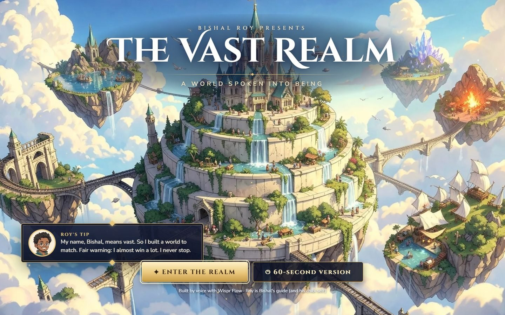</a>

</div>

---

## The idea

*Bishal* means **vast** in Bengali. So instead of a page of bullet points, the portfolio is a whole world:

- **The Vast City** in the middle, with six realms floating around it, joined by stone bridges and rune-stone paths.
- **Roy** (a chibi version of me) as your guide. He flies you from realm to realm in his hot-air balloon.
- **Every realm tells one part of the story.** The journey is a train that changes engines at every setback. The wins are towers whose reflections show what they cost. The projects are shops in a night market, each handing you an item card with the real numbers.

It is also an honest portfolio: the failures sit right next to the wins, because both are true at the same time.

> **No time?** Every screen has a **60-second version** button: the whole story on one card, with email, résumé and LinkedIn.
>
> **New here?** The first time you enter a realm, a welcome card explains what the place is and how to explore it; the **?** button brings it back.

---

## The world

<table>
<tr>
<td width="50%">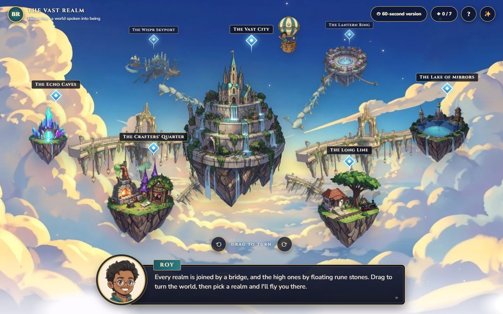</td>
<td width="50%">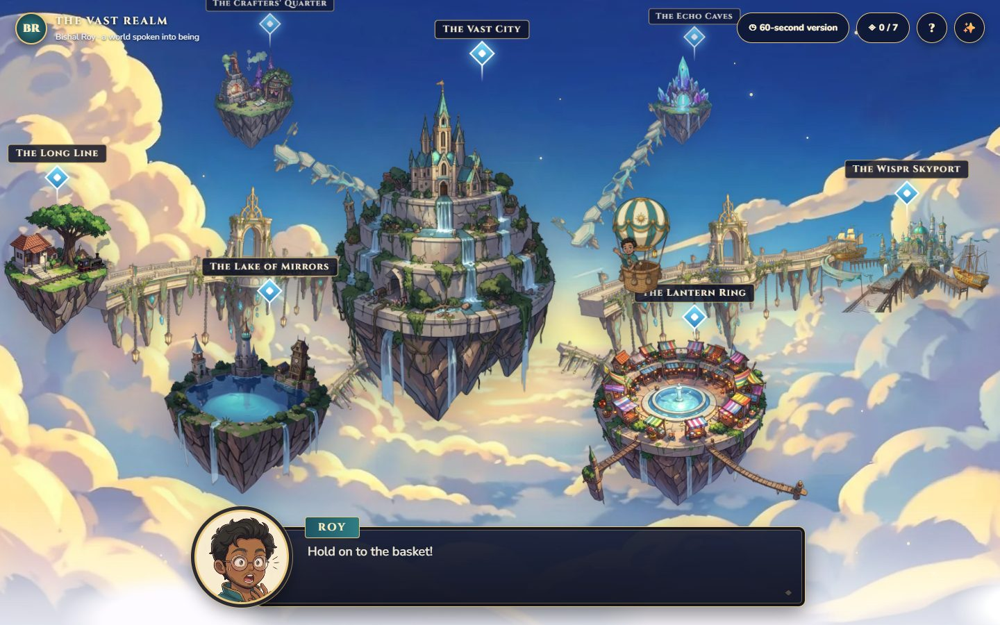</td>
</tr>
<tr>
<td><b>A 360° world.</b> Drag to turn it. Islands at the back fade into the haze; bridges re-join as you spin.</td>
<td><b>Travel by balloon.</b> Pick a realm: the world turns to face it, Roy's balloon flies over, the clouds close, and the realm's name appears.</td>
</tr>
</table>

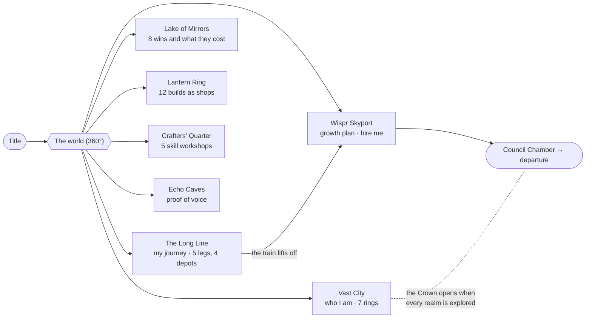

---

## The seven realms

### The Vast City: who I am, ring by ring
Seven rings climb the city: **Roots** (Chandrapur) → **Values** → **Learning** → **Work** → **the Trophy Hall** → **Community** → **the Crown**. The Crown holds a sealed letter that opens only for visitors who explore every realm.

<table><tr>
<td>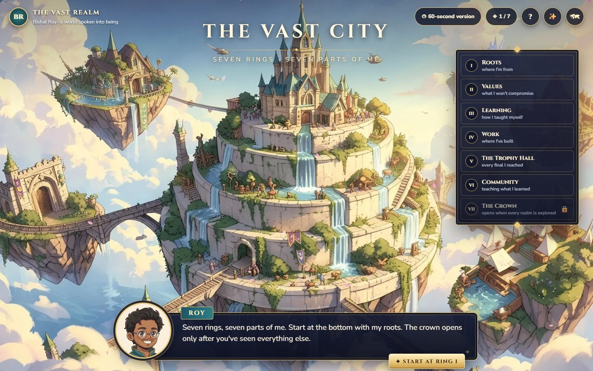</td>
<td>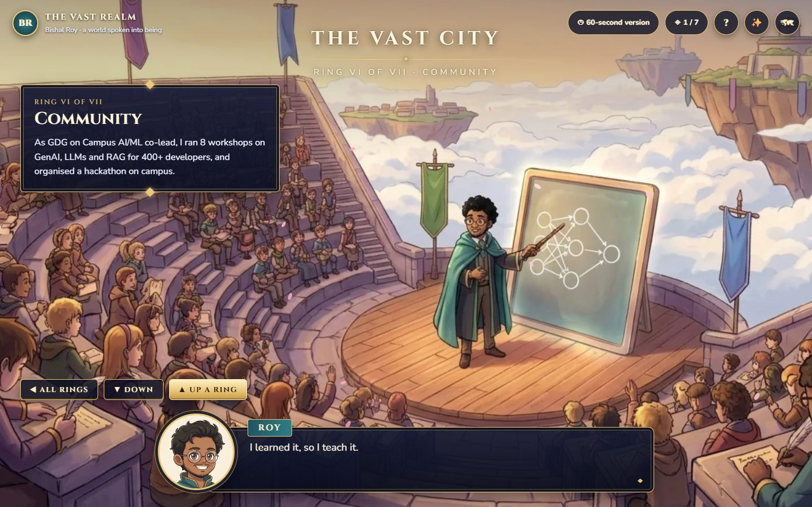</td>
</tr></table>

### The Long Line: my journey as a train
Steam (school in Chandrapur) → diesel (college in Pune) → electric (the hackathons) → bullet (the grind) → **a sky-train that lifts off the rails**. Every setback is a **depot**. The train stops, the story plays (*what happened, how I came back*), and when you press **Roll out**, sparks fly, the screen flashes, and a new engine rolls out. Each leg has its own punched ticket.

<table><tr>
<td>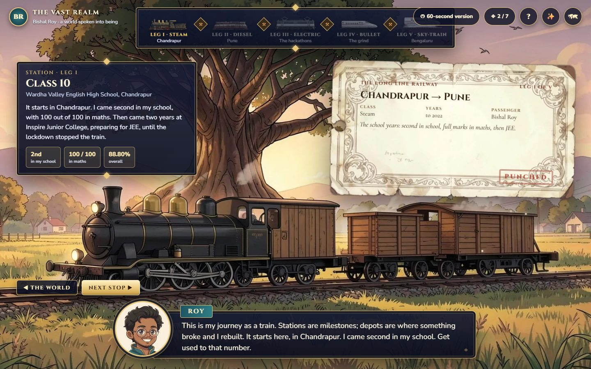</td>
<td>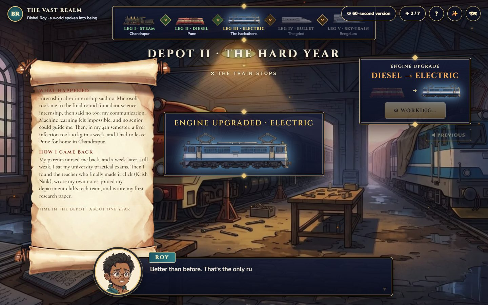</td>
<td>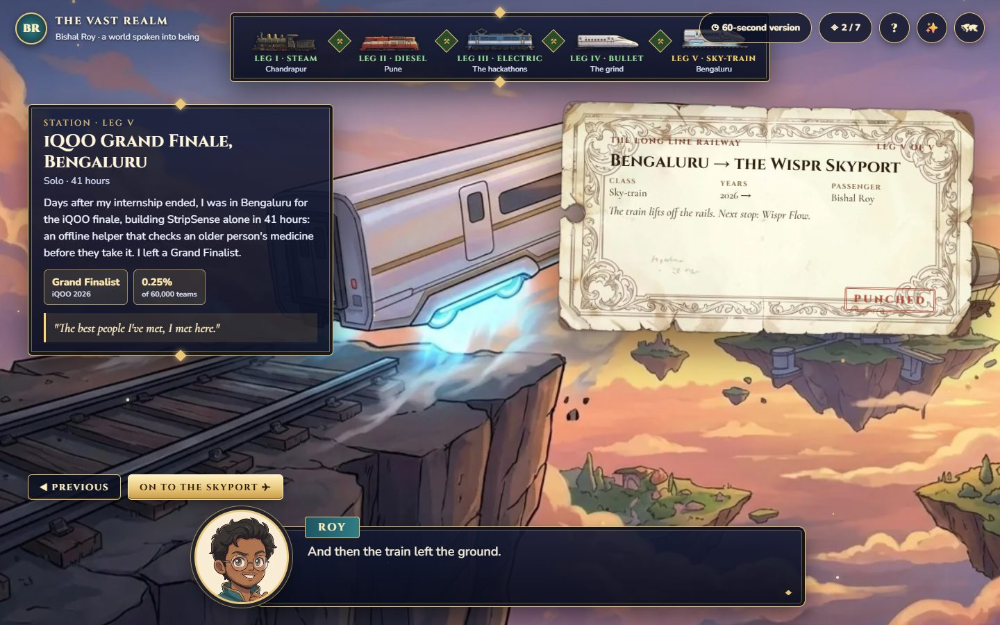</td>
</tr></table>

### The Lake of Mirrors: eight wins, and what each one cost
Eight towers stand in a still lake, each with gold-mended cracks, and each one stands for something (the Lighthouse keeps its light on through the storm: my health, and coming back). Tap a tower and the camera flies in, but at first you only see **the win**. **Turn the mirror** and the tower flips: **the reflection** shows what that win cost me, and **the gold** shows how I mended it. Turn the whole lake and the failures stand up while the wins become the reflection.

<table><tr>
<td>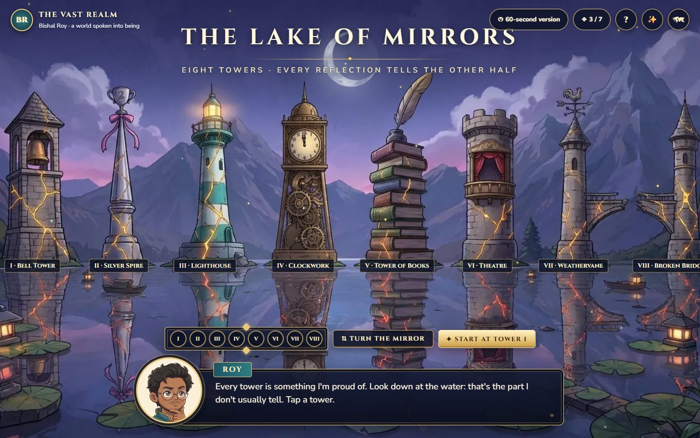</td>
<td>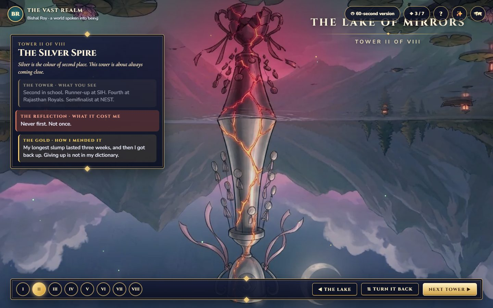</td>
<td>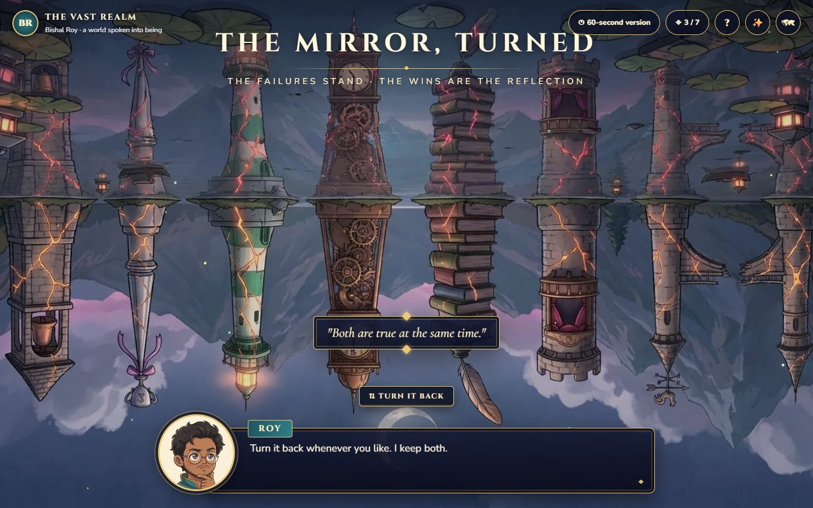</td>
</tr></table>

### The Lantern Ring: twelve builds, twelve shops
A round night market. Stand at the fountain and turn to browse; step inside a shop and it hands you an **item card** with the project's real numbers. Collect all twelve to fill your bag.

<table><tr>
<td>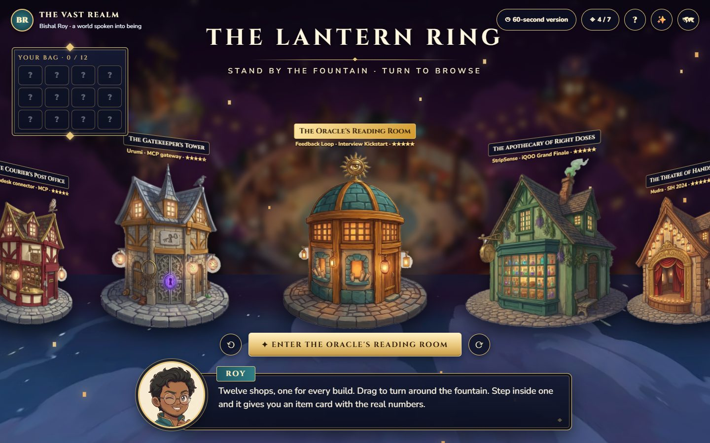</td>
<td>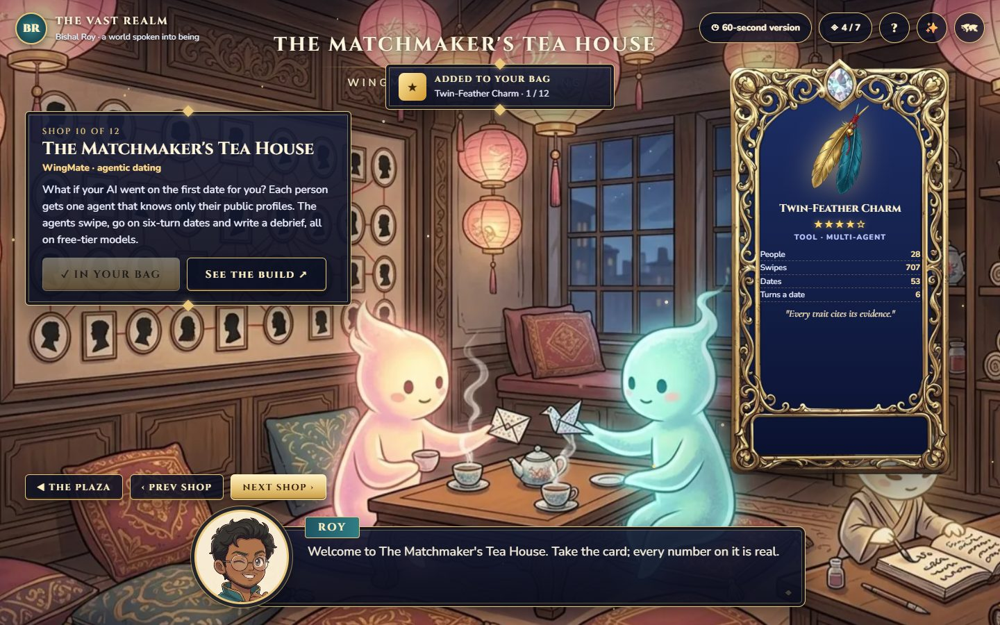</td>
</tr></table>

| Shop | Build | The real numbers |
|---|---|---|
| The Oracle's Reading Room | **Feedback Loop** · Interview Kickstart | a 4-hour class → feedback in ~9 min for ~$1 · 3,000+ classes scored · 850+ tests |
| The Apothecary of Right Doses | **StripSense** · iQOO Grand Finalist | built solo in 41 h · 610 unit tests · fully offline, on-device Gemma |
| The Theatre of Hands | **Mudra** · SIH 2024 runner-up | Indian Sign Language ↔ text, both ways |
| The Scouts' Guild | **Cricket Scout** · Rajasthan Royals, 4th (solo) | 602,992 deliveries · 2,714 matches |
| The Bridge-Builders' Office | **Kakehashi** · India → Japan | 0 contradictions in 132 fact checks |
| The Wind-Eye Observatory | **VayuNetra** | 6 cities at ward level · 72 h forecasts · 7 languages |
| The Assay House | **C-TRUST** · Novartis NEST 2.0 semifinalist | 7 agents + a guardian · 331 tests |
| The Appraiser's Scales | **Smart Pricing** · Amazon ML 2025 | top 8% (team) · 75,000 products · text + image |
| The Bone-Reader's Clinic | **Knee MRI** · RSNA on Kaggle | 12 findings · 0.91 macro ROC-AUC on 1,102 held-out studies |
| The Matchmaker's Tea House | **WingMate** · agentic dating | 28 people · 707 swipes · 53 six-turn agent dates |
| The Courier's Post Office | **Freshdesk connector** · MCP | 10 typed tools · backoff + circuit breaker |
| The Gatekeeper's Tower | **Urumi** · MCP gateway | 4 layers · 49 tests · Kubernetes (Helm) |

### The Crafters' Quarter: five workshops, five families of skills
Dwarves (engineering), alchemists (data & ML), witches (generative AI), elves (research), bards (communication). Press the action (*strike the anvil*, *stir the cauldron*, *cast the next page*…) and the item grows one stage, with a flash and a burst of the real tool logos.

<table><tr>
<td>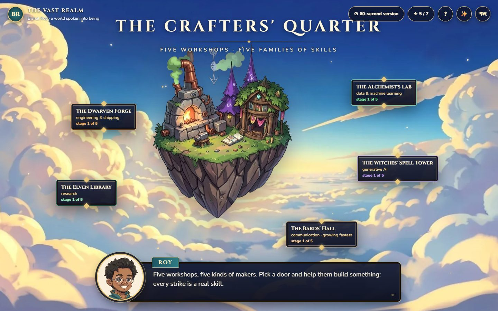</td>
<td>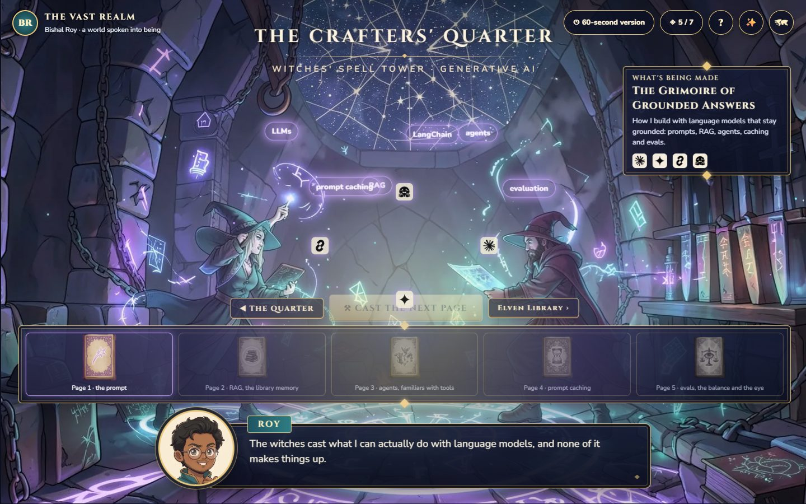</td>
</tr></table>

### The Echo Caves: proof of voice
Every crystal holds a sentence I actually dictated while building this world, word for word. And the cave listens: **hold the crystal and say "take me to the lake"**, and it lights up and sends you there (Web Speech API; other browsers get phrase buttons).

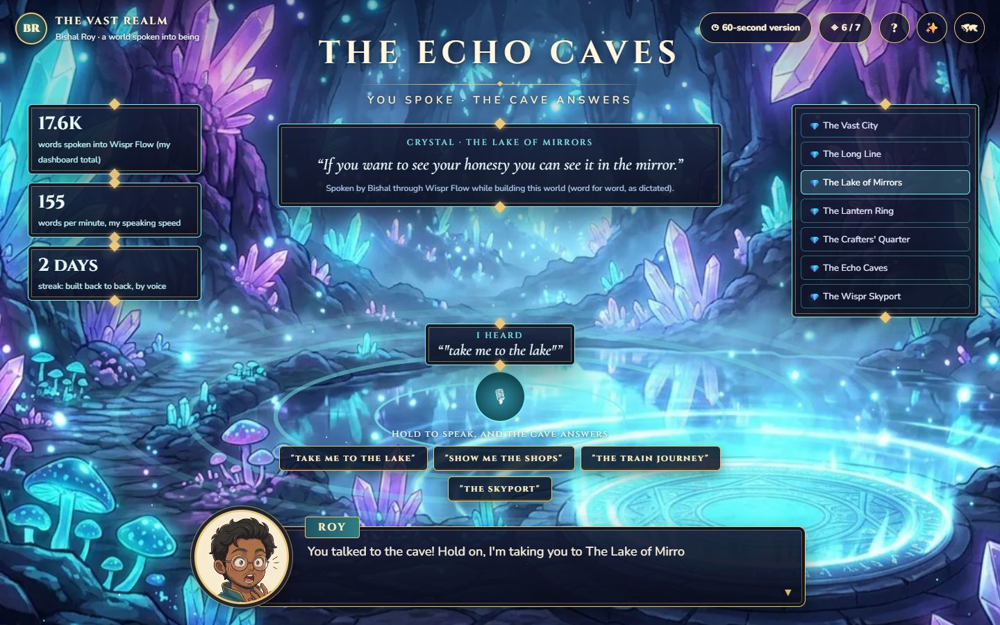

### The Wispr Skyport: where the line ends
Three flight plans for Wispr Flow India (**Ghar ka Flow**, **Campus Flow**, **Bolo, type mat karo**), my first 30 days, then the **Council Chamber**: the "hire me" moment, written as a treaty. Then the airship departs.

<table><tr>
<td>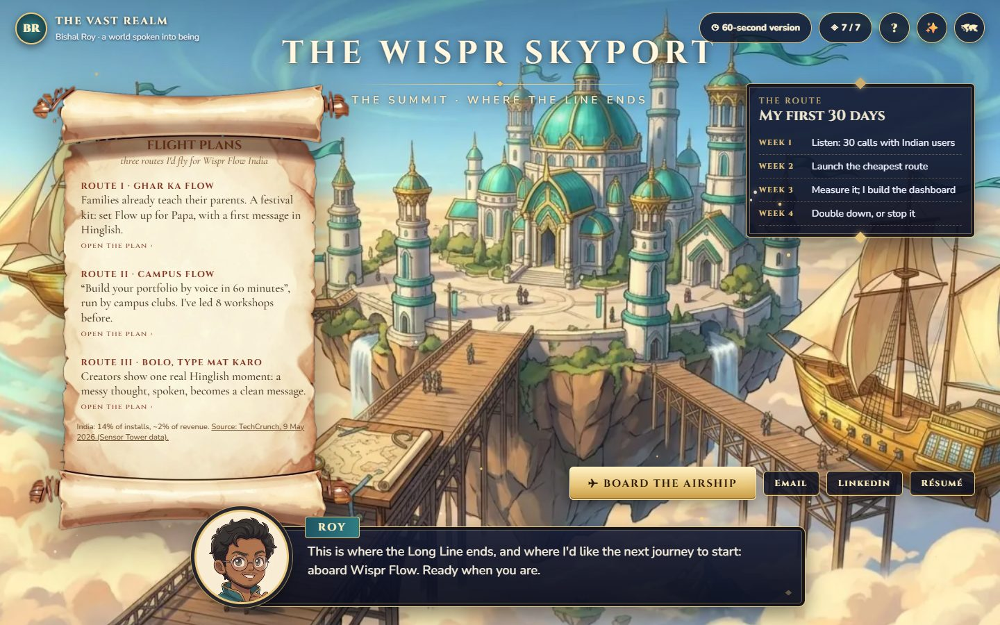</td>
<td>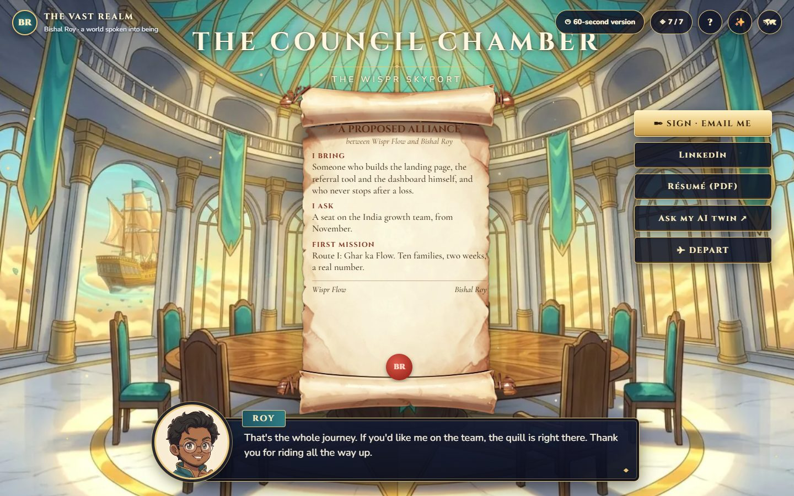</td>
<td>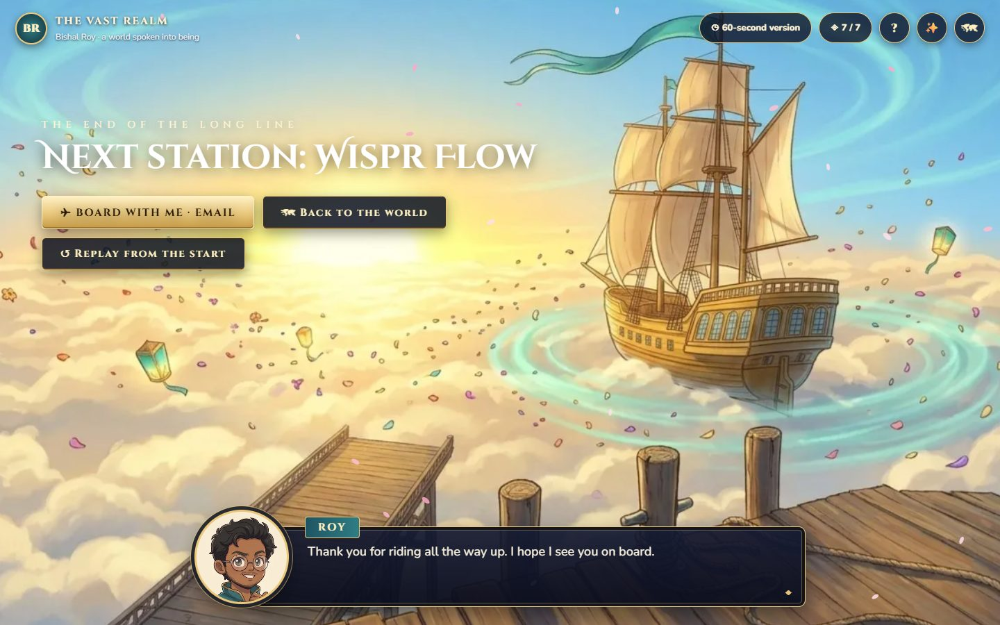</td>
</tr></table>

---

## Built by voice

| | |
|---|---|
| **Words dictated through Wispr Flow** | **17.6K** |
| **Speaking speed** | **155 wpm** |
| **How** | Every decision, every round of feedback and every story was spoken through **Wispr Flow** to **Claude Code**, which wrote the code |
| **Art** | Generated with Google Gemini and FLUX (Cloudflare Workers AI). Every image was reviewed for accuracy, consistency and story flow, and redone when it fell short (one shop set was redrawn because eight shops came out as the same dome) |
| **Facts** | Every number is checked against my own verified records. Nothing is rounded up; private code is marked private |

---

## Engineering

**Stack:** React 19 · Vite · framer-motion · plain CSS · Canvas 2D · Web Speech API · Vercel.

- **One stage, any screen.** Every scene is laid out on a 1440×900 stage that scales to fit the window, while the paintings always fill the whole screen. Phones held upright switch to their own 820×1460 layout.
- **A hand-rolled 360° ring** drives both the world map and the shop plaza: drag with momentum, snap to the nearest slot, depth sorting, and bridges that follow each island as it turns.
- **Living paintings.** The backgrounds drift slowly, lean with the pointer, and carry particles (embers, petals, fireflies, lanterns, crystal sparks).
- **Transitions:** cloud wipes that preload the next realm while they cover the screen, the balloon flight, the depot engine change, the lake fly-in, a light bloom when you enter a shop, and a forge flash with a logo burst.
- **Content as data.** Every word on the site lives in one file, [`src/content.js`](src/content.js).
- **Progress is remembered** (`localStorage`): realms visited, your bag of item cards, the stage of every workshop.
- **Every realm explains itself.** A welcome card on first entry (what it is, how to explore), a ? button to reopen it, and a plain-words description for every project and workshop.
- **Accessible and calm when asked.** Keyboard navigation (arrows, Enter, Esc, M for the map), focus rings, alt text, and a ✨ switch in the HUD that turns the animations off.
- **Light.** 133 paintings as WebP (12 MB in total), loaded realm by realm; the JavaScript bundle is about 120 KB gzipped.

```
src/
├─ content.js            every word on the site (facts verified)
├─ App.jsx               router, cloud-wipe transitions, HUD, the 60-second overlay
├─ components/           Stage (scaling), Living (parallax paintings), Particles, UI
├─ lib/                  routing, preloading, saved progress, motion switch
└─ scenes/               Title · World · VastCity · LongLine · Lake · LanternRing · Crafters · Echo · Skyport
public/art/<realm>/      the paintings (WebP)
tests/                   the test robot
```

### Quality

The repo ships a test robot that drives real Microsoft Edge through the site:

- **`tests/robot.mjs`** opens every screen (22 of them) and fails on any console error, failed request, or panel/button that ends up off-screen. It runs at **7 window sizes**: 1280×720, 1366×768, 1440×900, 1536×864, 1915×852, 1920×1080, and a 390×844 phone.
- **`tests/flows.mjs`** clicks through the real journeys and checks that each animation actually appears. It covers: title → world, island → balloon flight → realm, tower fly-in, depot sparks → flash → engine banner → next leg, entering a shop and saving the card, forge strikes and the logo burst, the echo lighting up and travelling, the 60-second overlay, board → council → depart, and dragging the world.
- Both run with the operating system's *reduce motion* setting switched on, so the experience is checked on machines where Windows animation effects are off.

```bash
npm install
npm run build && npx vite preview --port 4173

node tests/robot.mjs --size=1915x852    # or --mobile
node tests/flows.mjs                     # or --mobile
```

<table><tr>
<td width="33%">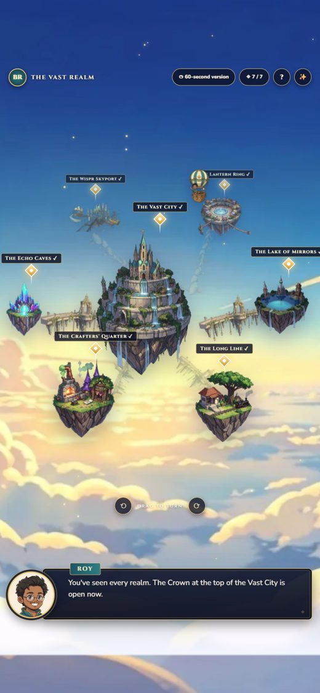</td>
<td width="33%">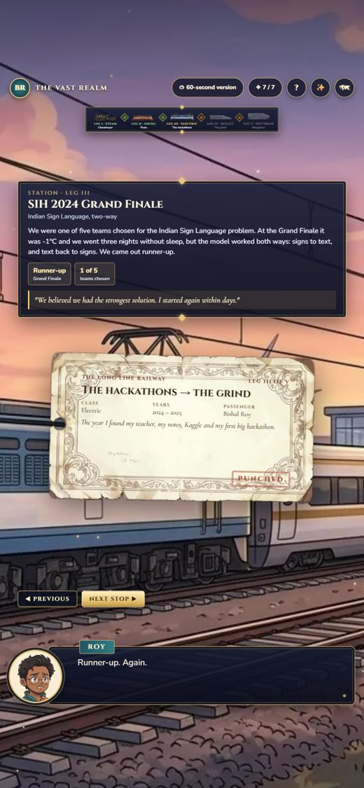</td>
<td width="33%">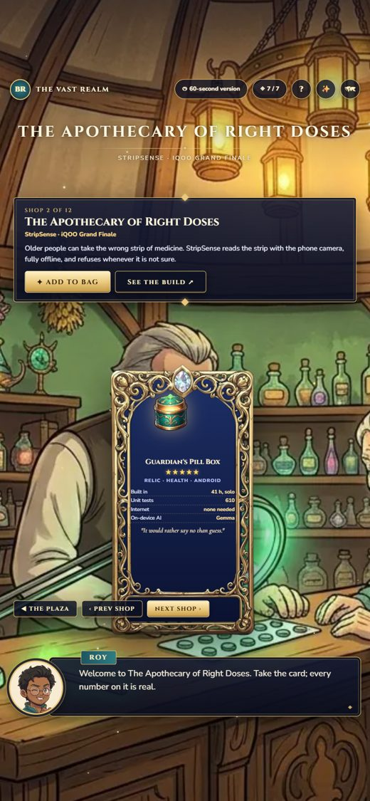</td>
</tr></table>

---

## Run it locally

```bash
git clone https://github.com/roybishal362/WisperFlow---Story---Bishal-Roy-.git
cd WisperFlow---Story---Bishal-Roy-
npm install
npm run dev
```

Deploying: import the repo into Vercel (Vite is detected automatically; the build command is `npm run build`, the output folder is `dist`). Every push to `main` redeploys.

## Credits

- **Art:** generated with Google Gemini and FLUX.2 (Cloudflare Workers AI), then reviewed and composited by me.
- **Tool logos:** [Simple Icons](https://simpleicons.org) (CC0).
- **Fonts:** Cinzel, Cinzel Decorative, Nunito and Cormorant Garamond (Google Fonts, OFL).
- **Market data:** the Skyport cites TechCrunch, 9 May 2026.

## Contact

**Bishal Roy** · [roybishal9989@gmail.com](mailto:roybishal9989@gmail.com) · [LinkedIn](https://www.linkedin.com/in/bishal-roy-5410b5257/) · [GitHub](https://github.com/roybishal362)

<div align="center"><sub>Next station: Wispr Flow.</sub></div>
